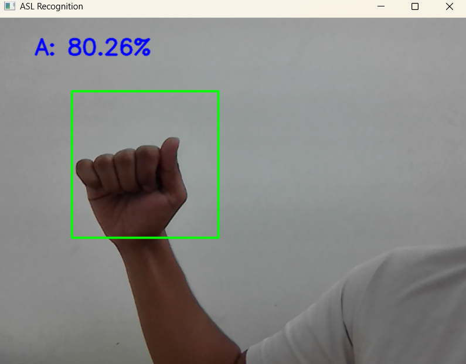
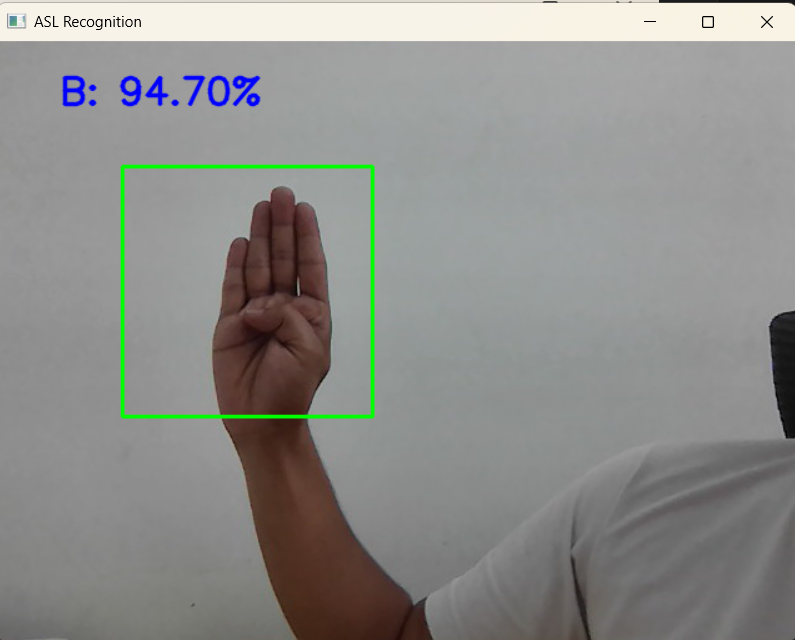
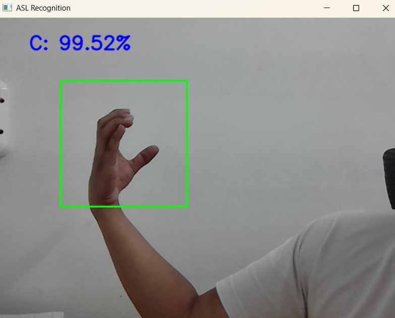
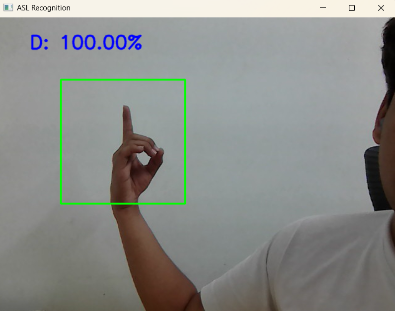
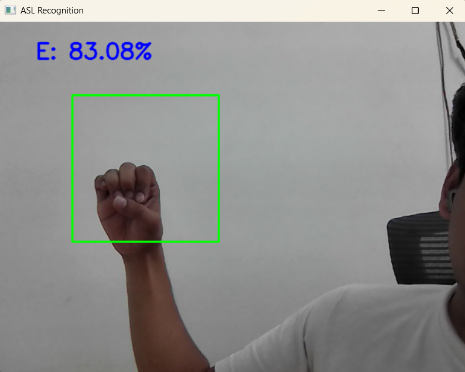
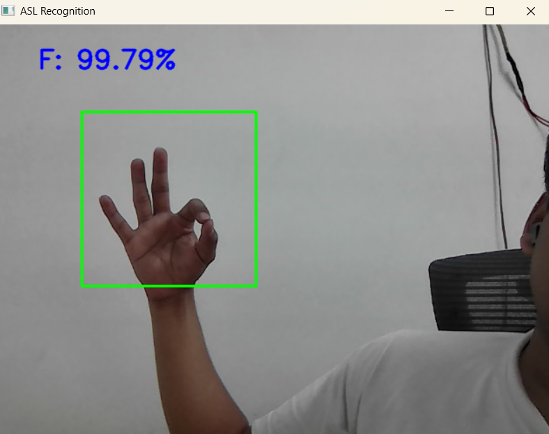

# Sign Language Recognition

A CNN that recognises American Sign Language (ASL) letters from images, and from a live webcam.

## Results

| | Accuracy |
|---|---|
| Training | 98.86% |
| Validation | 95.89% |
| Test (8,613 images, with augmentation) | 95.29% |


| Sign | Prediction |
|---|---|
|  | A |
|  | B |
|  | C |
|  | D |
|  | E |
|  | F |

## Data

[ASL Alphabet dataset on Kaggle](https://www.kaggle.com/datasets/grassknoted/asl-alphabet): 87,000 images in 29 classes
(A to Z, plus SPACE, DELETE and NOTHING). Every image is resized to 64 x 64.

## Model

A CNN built with TensorFlow/Keras: 64 x 64 x 3 input, 29 outputs, Adam optimiser and categorical cross-entropy loss.
The trained model is `SLR_final.h5`. It is too large for GitHub (over 100 MB), so download it from
[Google Drive](https://drive.google.com/drive/folders/1JjK75ni5MON4727yQDLzLVElz4cRE7QY?usp=sharing)
and put it in the project folder.

## Run it

```bash
git clone https://github.com/KrishSharma1903/Sign-Language-Recognition.git
cd Sign-Language-Recognition
pip install -r requirements.txt
jupyter notebook SignLanguageRecognition.ipynb
```

The notebook trains and tests the model. Its last cell opens your webcam and predicts the sign
in the box on screen (press `q` to quit).

`model_load.py` only checks that `SLR_final.h5` loads. `test_Data_Split.py` moves 10% of each class into a
test folder; change the two paths at the top to your own dataset folders first.

## Files

```
SignLanguageRecognition.ipynb   training, testing and the webcam demo
model_load.py                   loads the saved model
test_Data_Split.py              makes the test split
Results/                        confusion matrix and sample predictions
```

## License

[MIT](LICENSE)
